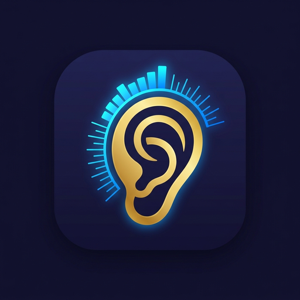
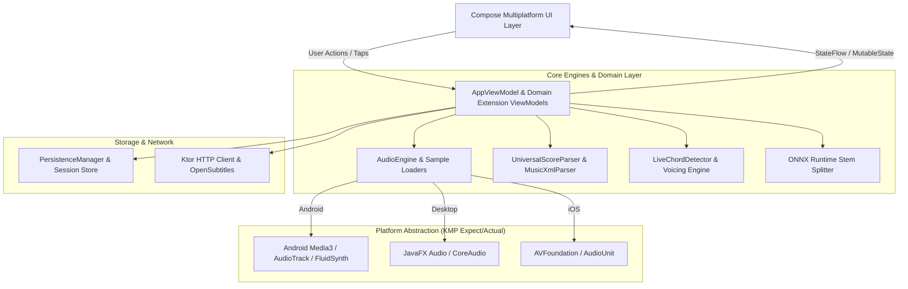

# 🎶 pEQ Learn — Universal Audio Workstation & Interactive Music Academy

<p align="center">
  
</p>


[](https://kotlinlang.org/)
[](https://www.jetbrains.com/lp/compose-multiplatform/)
[](https://developer.android.com/)
[](https://www.oracle.com/java/)
[](#)

> **pEQ Learn** is an advanced, production-grade cross-platform music education suite and digital audio workstation (DAW). It bridges Western music theory, digital audio DSP, multi-track neural stem isolation, and authentic Indian Classical (Hindustani & Carnatic) music systems into a cohesive, hardware-accelerated Compose Multiplatform application.

---

## 📑 Table of Contents
1. [Overview & Highlights](#-overview--highlights)
2. [Key Features](#-key-features)
   - [Interactive Music Academy](#1-interactive-music-academy)
   - [Neural Stem Splitter & Audio Mixer](#2-neural-stem-splitter--audio-mixer)
   - [Indian Classical Riyaaz & Drone Studio](#3-indian-classical-riyaaz--drone-studio)
   - [Universal Score & Tablature Engine](#4-universal-score--tablature-engine)
   - [Audiophile DSP & Media Engine](#5-audiophile-dsp--media-engine)
3. [System Architecture](#-system-architecture)
4. [File & Directory Structure](#-file--directory-structure)
5. [Tech Stack & Dependencies](#-tech-stack--dependencies)
6. [Supported Platforms](#-supported-platforms)
7. [Getting Started & Development](#-getting-started--development)
8. [Configuration & Environment](#-configuration--environment)

---

## 🌟 Overview & Highlights

- **Multiplatform Compose UI**: Shared declarative UI across Android, Desktop (macOS, Windows, Linux), and iOS targets.
- **Synthesia-Grade Waterfall Piano**: Full 88-key / 61-key / 49-key / 25-key piano with 3D perspective shaders, neon tube bloom, particle spark arcs, and zero-latency key strike visual feedback.
- **Neural AI Stem Isolation**: Local on-device and cloud-assisted vocal, drum, bass, and accompaniment extraction powered by ONNX Runtime.
- **Microtonal & Swara Intelligence**: Authentic Hindustani Thaats, Raagas, Carnatic Melakarta talas, and Radel-style digital tanpura & tabla machines with realistic drones and theka patterns.
- **Hardware Integration & Cast**: Google Cast v2 framework integration, USB MIDI device capture, low-latency audio engine, and biometric authentication.

---

## 🚀 Key Features

### 1. Interactive Music Academy
- **88-Key Studio Piano (`PianoKeyboard88Keys.kt`)**:
  - Interactive multi-touch keys with ivory and ebony physical bevel shaders.
  - Straight and 3D perspective falling note ribbons with pitch badge labels.
  - Velocity-sensitive particle physics and bloom flash collisions.
  - Sostenuto, Una Corda, and Damper pedals with physical brass gradients.
  - Dynamic chord detection via `LiveChordDetector`.
- **Chord Dictionary & Voicing Engine (`ChordDictionaryContent.kt`, `ChordVoicingEngine.kt`)**:
  - Comprehensive library of Major, Minor, 7ths, Suspended, Altered, Diminished, and Augmented chords.
  - Visual fingering diagrams for **Piano**, **Guitar**, and **Ukulele**.
  - Reverse chord identifier from any active MIDI note input.
- **Drum Academy & 3D Visualizer (`DrumAcademy.kt`, `ThreeDDrumVisualizer.kt`)**:
  - 3D physical drum kit with realistic bounce animations, kick pedals, and cymbal resonance.
  - Multi-track step sequencer with quantization and groove library presets.
  - Audio sample triggering via `DrumKitLoader`.
- **Encyclopedia of Music Theory (`MusicTheoryScreen.kt`)**:
  - Searchable guide covering intervals, scales, Circle of Fifths, harmonic cadences, and modulation.

### 2. Neural Stem Splitter & Audio Mixer (`PEQMixerScreen.kt`)
- **Real-Time Stem Isolation**:
  - 2-Stem (Vocals / Accompaniment)
  - 4-Stem (Vocals / Drums / Bass / Other)
  - 6-Stem (Vocals / Drums / Bass / Piano / Guitar / FX)
- **Studio Channel Strips**: Individual volume sliders, pan pots, mute/solo toggles, and peak VU metering.
- **Export Studio**: High-res WAV/MP3 stem mixdown and video visualization renderer.

### 3. Indian Classical Riyaaz & Drone Studio (`RadelTanpuraTablaStudio.kt`)
- **Digital Radel Hardware Emulation**:
  - Dual 4, 5, or 6-string electronic Tanpura drone synthesis (Pa-Sa-Sa-Sa / Ma-Sa-Sa-Sa / Ni-Sa-Sa-Sa).
  - Microtonal fine pitch offsets (Shruti/cent level tuning) across all 12 swaras.
  - Realistic multi-speed Tabla theka machine (Teentaal, Ektaal, Jhaptaal, Keherwa, Rupak, Dadra, Adi Tala, etc.).
- **Raaga & Thaat Knowledge Graph (`IndianMusicData.kt`, `CarnaticMusicData.kt`)**:
  - Hundreds of Hindustani Raagas mapped with Aaroh, Avroh, Pakad, Vaadi, Samvaadi, and Thaats.
  - Carnatic 72 Melakarta scale mappings and Swara transposition matrices (`SwaraMapper.kt`).

### 4. Universal Score & Tablature Engine (`StaffAndTabNotationViewer.kt`)
- **Score Formats**: Parses and renders MIDI (`.mid`), MusicXML (`.xml`, `.musicxml`), and guitar tablature.
- **Visual Playhead**: Measure-by-measure synchronized scrolling with tempo mapping.
- **Bi-Directional Highlighting**: Notes sounded on the score light up simultaneously on the piano keyboard and fretboard.
- **Dual Clef & Split Staff**: Treble, Bass, Alto, and Tenor clefs with left/right hand color distinction.

### 5. Audiophile DSP & Media Engine
- **Media3 / ExoPlayer Core**: Gapless playback, pitch shifting, speed alteration (0.25x – 2.0x), and loop markers.
- **Dynamic Waveform Seekbar (`WaveformSeekBar.kt`)**: Pre-computed audio amplitude envelopes with scrubbing.
- **Cast Framework**: Seamless streaming to Google Cast and AirPlay devices.
- **Metadata Management**: ID3 tag extraction via `jAudioTagger`, album art extraction via `Palette`, and synced LRC lyrics viewer.

---

## 🏛 System Architecture

The application adopts the **MVI / Unidirectional Data Flow (UDF)** architectural pattern adapted for Kotlin Multiplatform and Jetpack/Compose Multiplatform:



### Architectural Principles:
1. **Unidirectional Data Flow**: Single source of truth managed inside `AppViewModel` with modular extensions (`+Player`, `+Session`, `+Library`, `+Intelligence`).
2. **Platform Isolation**: Hardware-specific implementations (e.g., MediaSessionService, Biometrics, Cast Framework) reside strictly under `androidMain`, `desktopMain`, or `iosMain` using Kotlin `expect`/`actual`.
3. **Decoupled 60fps Graphics**: Waterfall ribbons and particle engines use decoupled animation frame tickers (`withFrameMillis`) to prevent unnecessary Compose recomposition passes.

---

## 📂 File & Directory Structure

```text
pEQ-Learn/
├── build.gradle.kts                      # Root Gradle configuration
├── settings.gradle.kts                   # Project module declarations
├── gradle/
│   ├── wrapper/                          # Gradle wrapper binaries
│   └── libs.versions.toml                # Version catalog (dependencies & plugins)
└── composeApp/
    ├── build.gradle.kts                  # Multiplatform build script & targets
    └── src/
        ├── commonMain/                   # Multiplatform Shared Core
        │   ├── kotlin/com/creativeblisslabs/peqlearn/app/
        │   │   ├── App.kt                # Application entry point & root layout
        │   │   ├── Tab.kt                # Primary navigation tabs
        │   │   ├── ai/                   # AI bridges, ONNX Stem Splitter, Subtitles
        │   │   ├── audio/                # AudioEngine, Codec Scanner, DrumKitLoader
        │   │   ├── data/                 # Domain entities, Raagas, Taals, Presets
        │   │   ├── ui/
        │   │   │   ├── components/       # Shared UI, Piano, Drums, NotationViewer, Seekbars
        │   │   │   ├── screens/          # Primary tabs (Piano, Drums, Mixer, Riyaaz, Dashboard)
        │   │   │   ├── sections/         # NowPlayingBar, HeaderSection, Controls
        │   │   │   ├── theme/            # pEQTheme, typography, color palettes
        │   │   │   └── viewmodel/        # AppViewModel and domain-specific extensions
        │   │   └── util/                 # MIDI/MusicXML parsers, ChordVoicing, SwaraMapper
        │   └── composeResources/         # Shared drawables, fonts, audio samples, assets
        ├── androidMain/                  # Android-specific Implementations
        │   ├── AndroidManifest.xml       # Manifest, permissions, hardware features
        │   └── kotlin/.../
        │       ├── MainActivity.kt       # Activity lifecycle, WindowInsets, orientations
        │       ├── services/             # pEQMediaSessionService, Background Playback
        │       └── cast/                 # Google Cast v2 framework integration
        ├── desktopMain/                  # Desktop (JVM) Native Audio & Window hooks
        └── iosMain/                      # iOS Native AudioSession & platform bridges
```

---

## 🛠 Tech Stack & Dependencies

### Core Languages & Frameworks
| Technology | Description |
|---|---|
| **[Kotlin](https://kotlinlang.org/)** (v2.2.0) | Modern, multiplatform, memory-safe programming language |
| **[Compose Multiplatform](https://www.jetbrains.com/lp/compose-multiplatform/)** (v1.7.1) | Declarative UI toolkit by JetBrains based on Google Jetpack Compose |
| **[Coroutines & Flow](https://github.com/Kotlin/kotlinx.coroutines)** (v1.8.1) | Asynchronous reactive concurrency |
| **[Kotlinx Serialization](https://github.com/Kotlin/kotlinx.serialization)** (v1.6.2) | Type-safe JSON serialization & session persistence |

### Audio, DSP & Multimedia
| Library | Usage |
|---|---|
| **AndroidX Media3 (ExoPlayer)** (v1.2.1) | Production-grade media playback, audio caching, and streaming |
| **Media3 Session** | Background MediaSession integration and notification controls |
| **FluidSynth KMP** | High-fidelity SoundFont (SF2) software synthesizer rendering |
| **ONNX Runtime Android** (v1.17.1) | Deep learning neural stem separation engine |
| **jAudioTagger** (v3.0.1) | Comprehensive audio metadata & ID3 tag manipulation |
| **Kamel Image** (v0.9.5) | Async multiplatform image loading and disk cache |

### Networking & Cloud
| Library | Usage |
|---|---|
| **Ktor Client** (v2.3.8) | Multiplatform asynchronous HTTP client (OkHttp / CIO / Darwin) |
| **Play Services Cast Framework** | Casting audio streams to smart speakers & Chromecast |
| **AndroidX WorkManager** (v2.9.0) | Background media downloading and processing queues |

---

## 📱 Supported Platforms

- **Android**: Phones, Foldables, and Tablets (Min SDK 24, Target SDK 34).
- **Desktop**: macOS (Intel & Apple Silicon `aarch64`), Windows, and Linux via JVM 17+.
- **iOS**: iPhone & iPad via Kotlin Multiplatform iOS targets (`iosX64`, `iosArm64`, `iosSimulatorArm64`).

---

## 💻 Getting Started & Development

### Prerequisites
1. **JDK 17**: Ensure `JAVA_HOME` points to Java 17.
2. **Android Studio Hedgehog / Ladybug** or **IntelliJ IDEA Ultimate** with:
   - Kotlin Multiplatform Mobile plugin
   - Compose Multiplatform IDE support
3. **Android SDK** (API 34) and Build Tools installed.

### Build and Run

#### Android
```bash
# Debug APK compilation
./gradlew :composeApp:assembleDebug

# Install on connected device or emulator
./gradlew :composeApp:installDebug
```

#### Desktop (macOS / Linux / Windows)
```bash
./gradlew :composeApp:run
```

#### Run Unit Tests
```bash
./gradlew :composeApp:test
```

---

## ⚙️ Configuration & Environment

Sensitive keys, keystores, and environment variables are excluded from version control via `.gitignore`:
- `local.properties`: Defines Android SDK location, keystore paths, and release alias.
- `.env`: API credentials (e.g., OpenSubtitles, Cloud AI service tokens).

---

## 👥 Authors & Maintainers

- **Manu Singh** ([@I-am-Manu-Singh](https://github.com/I-am-Manu-Singh))
- **Creative Bliss Labs**

*Crafted with precision for musicians, learners, and audio engineers.*


---

## 📱 App Screenshots

<p align="center">
  <table>
    <tr>
      <td align="center" width="25%">
        <br />
        <b>1. Main Screen</b>
      </td>
      <td align="center" width="25%">
        <br />
        <b>2. Core Experience</b>
      </td>
      <td align="center" width="25%">
        <br />
        <b>3. Interactive Mode</b>
      </td>
      <td align="center" width="25%">
        <br />
        <b>4. Advanced Features</b>
      </td>
    </tr>
    <tr>
      <td align="center" width="25%">
        <br />
        <b>5. Workflow / Details</b>
      </td>
      <td align="center" width="25%">
        <br />
        <b>6. Studio Console</b>
      </td>
      <td align="center" width="25%">
        <br />
        <b>7. Settings & Config</b>
      </td>
      <td align="center" width="25%">
        <br />
        <b>8. Dark & Light Theme</b>
      </td>
    </tr>
  </table>
</p>
